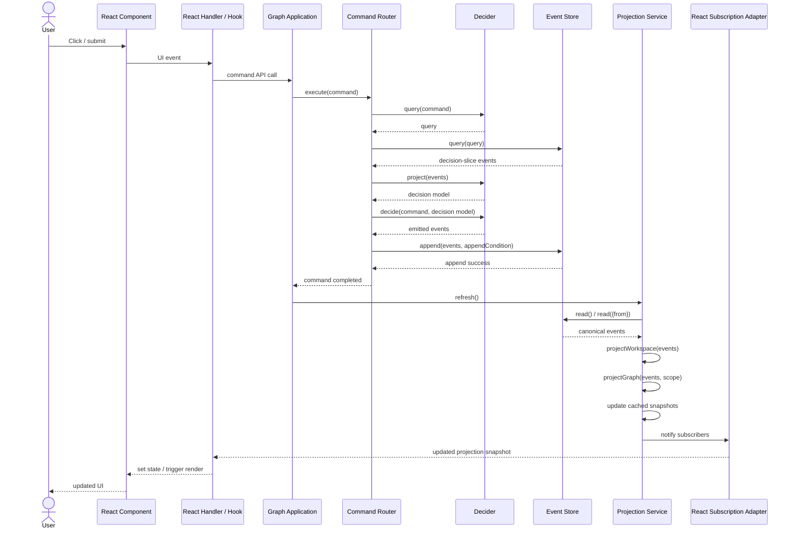

# Read-model subscriptions plan

## Summary

Introduce an application-owned projection and subscription layer for `apps/slicr-dcb` so React consumes workspace and scoped graph read models through subscriptions instead of owning projection refresh timing directly. The first iteration should be additive: keep `eventSourcedGraphModel.ts` as a compatibility facade while moving projection refresh, caching, and subscriber notification into a new application service.

The intended destination beyond v1 is query-driven projector ownership: each projector declares the `Query` for the event slice it needs, uses that same `Query` both to read its initial events from the store and to subscribe to matching store updates, and therefore no longer depends on an explicit application-level `refresh()` call.

## Goals

- Make projection/read-model ownership explicit in the application layer.
- Expose separate subscriptions for workspace and scoped graph projections.
- Keep the event store as the single source of truth.
- Keep checkpoint / sequence-position tracking internal in v1.
- Reduce React coupling to projection refresh mechanics and store reads.
- Preserve current behavior while migrating under the existing `eventSourcedGraphModel` boundary.
- Keep the v1 design compatible with a later query-driven subscription model where explicit `refresh()` is no longer needed.

## Non-goals

- Fully replacing `eventSourcedGraphModel.ts` in v1.
- Exposing raw event subscriptions to React.
- Adding public checkpoint or catch-up APIs in v1.
- Fully implementing query-driven store subscriptions in v1.
- Reworking command routing, decider behavior, or existing DCB append-condition semantics.
- Broadly rewriting React component state that is unrelated to projection ownership.

## Core rules

1. React components and hooks must subscribe to read models, not domain events.
2. The canonical event source remains `commandStore`; no new authoritative event mirror may be introduced in React or hook state.
3. Projection refresh is owned by an application service that reads from the event store and derives workspace and graph snapshots.
4. Graph projection is derived from event arrays or equivalent event-reader inputs, not by re-wrapping freshly read events into a temporary `MemoryStore` inside `eventSourcedGraphModel.ts`.
5. Workspace projection and graph projection are separate subscription channels.
6. Successful command execution must lead to projection refresh before subscribers observe the updated snapshot.
7. Scope changes for graph consumers must recompute the visible graph from canonical projection inputs, without changing workspace state.
8. The application projection service owns the conversion from domain graph to React-facing renderer graph by calling `adaptModelGraphToRenderer(...)` after domain graph projection.
9. Projectors should move toward explicitly declaring the `Query` that defines their event slice, so the same `Query` can eventually drive both initial reads and store-backed subscriptions.
10. Internal sequence/checkpoint tracking may exist to support efficient refresh later, but it must not become part of the React-facing API in v1.

## Data model

### Projector shape destination

The desired long-term shape is for each projector to own both its derivation logic and the `Query` that identifies the events it cares about.

Illustrative shape:

```ts
type Projector<Scope, Projection> = {
  query(scope: Scope): Query;
  project(events: readonly DcbEvent[], scope: Scope): Projection;
};
```

In that destination model:

- `query(scope)` defines the authoritative event slice for the projector
- the same query is used for the initial store read
- the same query is used to subscribe to future matching events
- explicit `refresh()` becomes an internal compatibility mechanism or disappears entirely

### Public application-layer concepts

```ts
type GraphModelScope = {
  projectId?: string;
  chapterId?: string;
};

type Subscription = {
  unsubscribe(): void;
};

type GraphProjectionService = {
  refresh(): Promise<void>; // v1 compatibility API; intended to become internal once store-backed subscriptions exist

  getWorkspaceSnapshot(): WorkspaceProjection;
  subscribeToWorkspace(
    listener: (workspace: WorkspaceProjection) => void,
    options?: {emitCurrent?: boolean},
  ): Subscription;

  createScopedGraphView(initialScope?: GraphModelScope): {
    getScope(): {projectId: string; chapterId: string};
    setScope(scope: GraphModelScope): RendererGraph;
    getSnapshot(): RendererGraph;
    subscribe(
      listener: (graph: RendererGraph) => void,
      options?: {emitCurrent?: boolean},
    ): Subscription;
  };
};
```

### Internal projection state

The service may internally track:

- `lastSeenPosition?: number`
- latest canonical sequenced events or equivalent derived inputs
- current workspace snapshot
- per-scope graph snapshots and/or shared graph derivation inputs
- projector-owned `Query` definitions or compiled subscription descriptors
- workspace listeners
- graph listeners keyed by scoped view

Internal storage choice is flexible as long as it preserves the source-of-truth rule and does not leak raw events to React.

## Algorithm / derivation steps

### Refresh flow

1. Read canonical events from `commandStore`.
2. Record the highest observed sequence position internally.
3. Derive the workspace projection from the canonical events.
4. Derive graph projection inputs from the canonical events.
5. For each active scoped graph view, project a domain `ModelGraph` from canonical events.
6. Convert each domain `ModelGraph` into a `RendererGraph` by calling `adaptModelGraphToRenderer(...)` in the application projection service.
7. Recompute the cached renderer snapshot for each active scoped graph view.
8. Notify workspace subscribers if the workspace snapshot changed.
9. Notify each scoped graph subscriber if that scope's graph snapshot changed.

The first iteration may perform full replay on each refresh. Incremental replay is deferred.

### Query-driven destination flow

1. Each projector declares a `Query` for its scope.
2. The projection service uses that `Query` to load the initial event slice from the store.
3. The projection service subscribes to store updates using that same `Query`.
4. When matching events arrive, the service reprojects only the affected projector/view.
5. React subscribers receive updated read-model snapshots without an explicit application `refresh()` call.

### Scoped graph flow

1. A caller creates a scoped graph view with an optional requested scope.
2. The view resolves that requested scope against the current workspace rules.
3. The view exposes the resolved scope and current `RendererGraph` snapshot.
4. When `setScope(...)` is called, the view recomputes its graph snapshot from the service's canonical projection inputs by running domain graph projection and then `adaptModelGraphToRenderer(...)`.
5. The scoped view notifies its own subscribers if the visible renderer graph changes.
6. Scope changes do not read or append events directly from React.

### Command flow

1. React invokes an application command API.
2. The command API routes the command through the existing command router.
3. After successful command completion, the application refreshes projections from `commandStore`.
4. Subscribers receive updated workspace and/or graph snapshots.

## Renderer / interaction behavior

- React should be able to subscribe separately to:
  - workspace projection updates
  - the currently scoped graph projection
- Existing user-visible graph behavior should stay unchanged:
  - commands still update the graph/workspace after success
  - scope changes still resolve to valid project/chapter selections
  - transient UI state such as editing menus, focus, and drafts remains local to React hooks/components
- For v1, `useGraphModel.ts` may continue to bridge application snapshots into React state, but it should stop owning projection refresh policy.

### Data flow sequence



## Implementation shape

### Domain layer

- Extract or introduce a pure graph projection function, e.g. `projectGraph(events, projectId, chapterId?)`, that returns a domain `ModelGraph`.
- Keep `projectWorkspace(events)` as the workspace derivation entry point.
- Keep `adaptModelGraphToRenderer(model: ModelGraph): RendererGraph` as the domain-to-renderer adapter boundary, but do not call it from React.
- `GraphProjector` may remain temporarily as a compatibility wrapper if needed, but application code should no longer need the temporary `MemoryStore` path.

### Application layer

Add a new service, likely under `apps/slicr-dcb/src/application/`, such as:

- `graphProjectionService.ts`
- optional supporting scoped-view module if helpful

Responsibilities:

- read from `commandStore`
- build and cache workspace snapshot
- build domain graph projections per active scope
- convert domain graphs to `RendererGraph` snapshots via `adaptModelGraphToRenderer(...)`
- cache scoped renderer-graph snapshots
- manage subscriptions
- track internal sequence/checkpoint state
- keep projector query ownership explicit so the service can later switch from explicit refresh to store-backed query subscriptions without changing React-facing APIs

Update application bootstrap so the projection service is created alongside the command router-backed APIs.

### Compatibility layer

`eventSourcedGraphModel.ts` remains in v1 but becomes a thinner facade that:

- delegates command execution to the existing router/application APIs
- delegates projection reads and scope changes to the new projection service or scoped graph view
- consumes already adapted `RendererGraph` snapshots from that service
- stops directly rebuilding projections from ad-hoc event reads

### React hook layer

`useGraphModel.ts` should subscribe to:

- workspace snapshot updates
- one scoped graph view for the active project/chapter

It should continue owning only UI-transient state and command invocation glue.

## Test plan

### Projection service tests

Add focused tests for:

- initial refresh produces workspace and graph snapshots from store events
- workspace subscribers receive current and updated workspace snapshots
- scoped graph subscribers receive current and updated graph snapshots
- changing scope recomputes the graph snapshot from canonical projection inputs
- refreshing after store changes updates all active scoped views
- unsubscribe stops further notifications

### Graph model / facade tests

Update or add tests showing:

- `eventSourcedGraphModel.ts` no longer uses a temporary projection `MemoryStore`
- command methods still return updated snapshots after successful command execution
- scope changes remain behaviorally equivalent

### React-facing tests

Add or update focused hook/application tests showing:

- `useGraphModel.ts` reacts to projection subscription updates
- React-facing code does not need direct store reads to observe command results

### Validation

Use focused LLM-reporter tests first, then typecheck:

```sh
npm run test:llm --workspace=slicr-dcb -- graphProjectionService eventSourcedGraphModel useGraphModel
npm run typecheck --workspace=slicr-dcb
```

Broader validation can follow if needed.

## Deferred follow-up

- Replace explicit application-triggered `refresh()` with projector-owned query subscriptions against the store
- Introduce store APIs that support subscribing by `Query` and replaying from a sequence/checkpoint position
- Let each projector use the same `Query` for both initial reads and ongoing updates
- External live-store change observation instead of explicit in-app refresh triggers
- Public checkpoint/catch-up subscription APIs if another application consumer needs them
- Replacing `eventSourcedGraphModel.ts` entirely once the compatibility layer no longer adds value
- Incremental projection updates keyed by sequence position if full replay becomes too expensive
- Consolidating projection snapshots into a more general application store only if multiple features demand it
