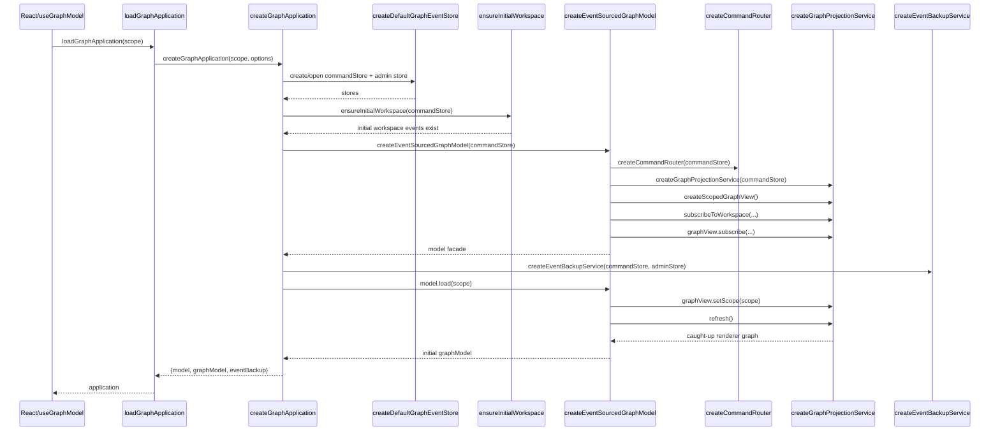
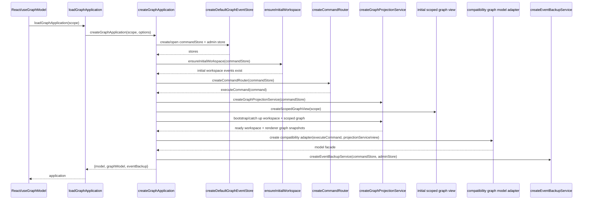

# Read-model subscriptions Tasks

## Feature Description

Introduce an application-owned, event-driven projection and subscription layer for `apps/slicr-dcb` so React submits commands and then observes workspace/scoped graph read-model updates through subscriptions. See [./02-plan.md](./02-plan.md) and [./data-flow.md](./data-flow.md).

## Workflow

Tasks should move through these status values in order:

- `[created]`: the task was described, but no work was done to implement it
- `[started]`: an agent sets this status before starting to work on a task
- `[done]`: an agent sets this status once a task is completed

**IMPORTANT**: Only **ONE** (1) task should be in the `[started]` status at a time.
Agents must update the task file as they work: set a task to `[started]` immediately before implementation begins, and set it to `[done]` as soon as that task is complete.

## Learnings

Add any learnings about the feature to `./05-learnings.md`.
Add any learnings about the project overall to the documents in the `./_knowledge` directory.

## Task 1: Extract pure graph projection

### Status

[done]

### Description

Refactor graph projection so application code can derive a model graph directly from canonical event arrays without creating a temporary `MemoryStore`. Keep behavior equivalent to the current `GraphProjector` semantics and preserve chapter-scoped filtering.

### Acceptance Criteria

- A pure graph projection entry point accepts graph-relevant events plus project/chapter scope and returns the same `ModelGraph` snapshots covered by current tests.
- `eventSourcedGraphModel.ts` can stop constructing a temporary `MemoryStore` for projection.
- Existing graph projection behavior for renamed, removed, retyped, moved, and connected nodes remains covered by focused tests.

### Dependencies

- None

### Notes

- This task is about derivation shape only; do not add subscriptions yet.
- `GraphProjector` may remain temporarily as a compatibility wrapper if that keeps the change small.

## Task 2: Add projection service with separate subscriptions

### Status

[done]

### Description

Introduce an application-layer projection service that reads canonical events from `commandStore`, derives workspace and graph snapshots, manages internal refresh state, and exposes separate subscription APIs for workspace and scoped graph views.

### Acceptance Criteria

- A new application service exposes workspace subscription and scoped graph-view subscription APIs matching the v1 plan.
- The service refreshes from `commandStore` and updates subscribed listeners with derived snapshots.
- Scoped graph views can change scope without React reading events directly.
- Workspace and scoped graph subscriptions default to immediate current-snapshot delivery unless `emitCurrent: false` is provided.
- Unsubscribed listeners stop receiving updates.

### Dependencies

- Task 1

### Notes

- Full replay on refresh was acceptable for this completed v1 step.
- This established the application-owned projection boundary that later tasks will make event-driven.

## Task 3: Add store-backed projector subscription infrastructure

### Status

[done]

### Description

Introduce the event-driven infrastructure needed for query-owned read models: store append/query notifications, projector catch-up wiring, and a subscription manager that owns sequenced projector instances. Projectors should use the same `Query` for initial catch-up and live matching of appended sequenced events.

### Acceptance Criteria

- The event store interface can notify subscribers about appended sequenced events from all appends made through that store instance, not only appends made through the graph application command path.
- Subscribers can be registered by `Query`, and only matching appended events trigger projector catch-up.
- A projector subscription manager creates sequenced projector instances, performs initial catch-up from the store using the same projector-owned `Query`, catches up after matching appends, and notifies projection listeners after event catch-up.
- Repeated notifications do not replay already applied events or double-apply projector state.
- Focused tests cover initial catch-up, later matching appends, ignored non-matching appends, unsubscribe, and no double replay.

### Dependencies

- Task 2

### Notes

- Keep raw event subscriptions internal to the application/event-sourcing layer; React must still subscribe only to read models.
- Use sequence/checkpoint state internally; do not expose checkpoint state through React-facing APIs.
- Guard against stale async work where applicable.

## Task 4: Route the graph projection service through store-backed projector subscriptions

### Status

[done]

### Description

Refactor `graphProjectionService.ts` so workspace and scoped graph views are backed by subscribed sequenced projector instances instead of a full canonical event cache and explicit full replay refreshes. Scope changes should recreate/resubscribe scoped graph projectors and deliver the new projection through the graph-view subscription channel.

### Acceptance Criteria

- Workspace projection updates are driven by matching store/projector notifications after appends.
- Scoped graph projection updates are driven by matching store/projector notifications after appends.
- The service no longer needs a full canonical event cache for normal scope recomputation.
- `ScopedGraphView.setScope(...)` returns `Promise<RendererGraph>` after the new scoped projector has caught up, and callers are not promised a synchronously recomputed graph from cached events.
- Rapid scope changes cannot apply stale projection results over a newer requested scope.
- Existing service tests are updated to prove event-driven updates, async scope changes, default current-snapshot delivery, and unsubscribe behavior.

### Dependencies

- Task 3

### Notes

- `refresh()` may remain as a bootstrap/compatibility method, but normal command-driven updates should flow from appended events through projector subscriptions.
- Domain-to-renderer adaptation remains owned by the application projection service.

## Task 5: Route the graph model facade through the projection service

### Status

[done]

### Description

Shrink `eventSourcedGraphModel.ts` into a compatibility facade that delegates projection state, scope handling, and command-result observation to the projection service while keeping existing command-oriented methods stable where practical.

### Acceptance Criteria

- `eventSourcedGraphModel.ts` no longer owns ad-hoc projection rebuilding from direct store reads.
- Command methods append through the command router and return after events are appended; updated graph/workspace snapshots are observed later through projection subscriptions that would also observe any other matching append made through the same store instance.
- Scope resolution and workspace access remain behaviorally equivalent for current consumers.
- Focused tests prove the facade relies on the projection service rather than temporary projection-store plumbing or direct projection refresh ownership.

### Dependencies

- Task 4

### Notes

- Keep the public shape stable enough that `useGraphModel.ts` can migrate separately, but allow async projection observation where needed.
- Do not entrench `refresh()` deeper into React-facing APIs; treat it as compatibility/bootstrap only.

## Task 6: Subscribe the React hook to application projections

### Status

[done]

### Description

Update `useGraphModel.ts` to consume workspace and scoped graph updates through the application subscription APIs while preserving its local UI-transient state management and command invocation glue.

### Acceptance Criteria

- `useGraphModel.ts` subscribes to workspace and graph snapshots instead of manually driving projection reload flow for normal updates.
- React callbacks submit commands; command promises resolve after append, and projection updates flow back into React through read-model subscriptions after matching events are appended and projectors catch up.
- Existing user-visible behaviors for loading, scope switching, and command-driven graph updates remain intact.
- Hook or integration tests prove React-facing code observes projection updates without direct store reads or raw event subscriptions.

### Dependencies

- Task 5

### Notes

- Keep local editing drafts, focus, menus, and debounce logic in the hook.
- Do not expose raw events or event-store primitives to React.

## Task 7: Tighten bootstrap and loader integration around projection ownership

### Status

[in progress]

### Description

Update application bootstrap and loader wiring so command APIs, projector subscriptions, and projection service initialization live in one consistent application boundary.

Current bootstrap flow:

Current complexity to preserve safely while refactoring:

- bootstrap ownership is split between `createGraphApplication.ts` and `eventSourcedGraphModel.ts`
- command router creation is hidden inside the facade
- projection service creation is hidden inside the facade
- the initial scoped graph view is created inside the facade
- initial catch-up is triggered indirectly through `model.load(scope)`
- `refresh()` remains part of the bootstrap/compatibility path

Target bootstrap flow:

Target ownership rule:

- `createGraphApplication.ts` is the composition root and owns bootstrap ordering.
- `graphEventStores.ts` owns only store creation/opening/reset/backup-store access.
- `commandRouter.ts` owns only command dispatch and decider lookup.
- `graphProjectionService.ts` owns only workspace/scoped graph read-model catch-up and subscriptions.
- `eventSourcedGraphModel.ts` remains a temporary compatibility adapter; it may adapt command/read-model APIs, but should not create stores, command routers, or projection services.
- `useGraphModel.ts` remains a React bridge that subscribes to read models and invokes application command APIs.

### Acceptance Criteria

- `createGraphApplication` and related loader code initialize command APIs and the projection service in one consistent application boundary.
- Initial load performs required lazy projector catch-up before first workspace delivery, scoped graph view creation, scope changes, or explicit bootstrap `refresh()`.
- Focused tests cover initial load plus subsequent event-driven subscribed updates through the application entry point.
- The resulting architecture leaves a clear path to removing `eventSourcedGraphModel.ts` in a later feature without requiring React to change ownership again.

### Dependencies

- Task 6

### Notes

- Keep this task focused on wiring and regression coverage, not on new product behavior.
- Preserve a clear migration path toward removing compatibility refresh/facade code once all React consumers use subscriptions directly.

## Task 8: Expose explicit graph application APIs

### Status

[created]

### Description

Add an explicit application-facing API from `createGraphApplication` that separates command execution, workspace read-model access, scoped graph read-model access, and event backup. Keep the existing `model` facade temporarily for compatibility while new consumers migrate to the clearer API.

### Acceptance Criteria

- `createGraphApplication` returns explicit command APIs for graph/workspace mutations without requiring callers to go through `application.model`.
- `createGraphApplication` returns explicit workspace read-model APIs for `getSnapshot()` and `subscribe(...)` behavior.
- `createGraphApplication` returns explicit scoped graph read-model APIs for creating scoped views and observing renderer graph snapshots.
- The existing `model` facade remains available temporarily and delegates to the same composed command/projection services.
- Focused tests prove the explicit APIs can bootstrap from existing events and observe command-driven projection updates.

### Dependencies

- Task 7

### Notes

- Keep this as an additive API step. Do not migrate React or delete the facade in this task.
- The explicit API should make ownership obvious: commands submit commands; read-model APIs expose projections/subscriptions.

## Task 9: Migrate `useGraphModel` off `eventSourcedGraphModel`

### Status

[created]

### Description

Update `useGraphModel.ts` to use the explicit graph application APIs from Task 8 instead of calling through `application.model` or `eventSourcedGraphModel` methods.

### Acceptance Criteria

- `useGraphModel.ts` invokes command functions through the explicit application command API.
- `useGraphModel.ts` subscribes to workspace and scoped graph projections through the explicit application read-model APIs.
- `useGraphModel.ts` no longer depends on `application.model` in production code.
- Existing React-facing behavior for initial load, scope switching, reload/reset, and command-driven updates remains intact.
- Focused hook/integration tests prove the hook observes projection updates without depending on the compatibility facade.

### Dependencies

- Task 8

### Notes

- Preserve local UI-transient state ownership in the hook.
- Do not expose raw event-store or domain-event primitives to React while migrating the API calls.

## Task 10: Remove the `eventSourcedGraphModel` compatibility facade

### Status

[created]

### Description

Remove `eventSourcedGraphModel.ts` once production consumers use the explicit graph application APIs. Migrate useful facade tests to application, command, projection-service, or hook tests before deleting obsolete coverage.

### Acceptance Criteria

- No production code imports or constructs `eventSourcedGraphModel.ts`.
- The compatibility facade file is deleted or reduced to test-only legacy code that is no longer part of production builds.
- Useful behavior coverage from `eventSourcedGraphModel.test.ts` is preserved at the appropriate application/projection/command layer.
- Application composition remains owned by `createGraphApplication.ts`.
- React continues to use read-model subscriptions and application command APIs only.

### Dependencies

- Task 9

### Notes

- This task should remove compatibility code only after the explicit API and React migration are stable.
- Prefer moving tests before deleting the facade so regressions remain visible.

## Task 11: Remove public bootstrap `refresh()` from normal application flow

### Status

[created]

### Description

Tighten projection-service bootstrap semantics after the facade is gone. Keep catch-up behavior available where needed, but remove `refresh()` from normal public application flow or rename/narrow it so it is clearly bootstrap/internal compatibility only.

### Acceptance Criteria

- Normal application command/update paths do not call public `refresh()`.
- Initial workspace and scoped graph catch-up are expressed through application bootstrap or scoped-view readiness APIs.
- `GraphProjectionService.refresh()` is either made internal, renamed to a bootstrap-specific operation, or otherwise documented as not part of React/application update flow.
- Focused tests prove initial catch-up and command-driven subscription updates still work without normal application callers invoking `refresh()`.

### Dependencies

- Task 10

### Notes

- This task is about API clarity and lifecycle ownership, not changing read-model behavior.
- Keep projector catch-up and sequence tracking internal to the projection/application layer.
