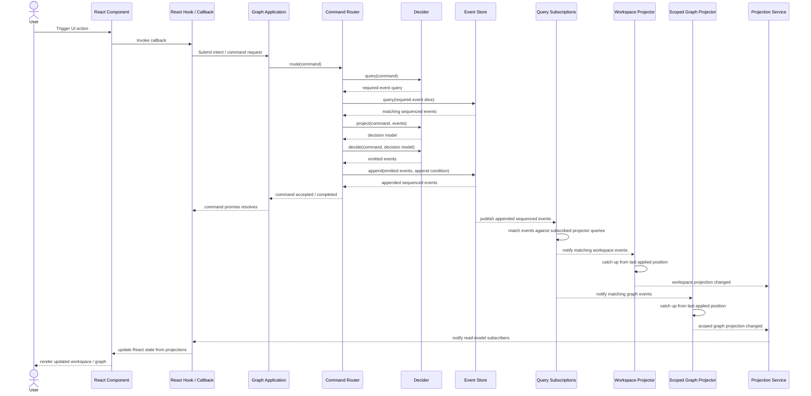

# Event-driven read-model data flow

## Design notes

- React never subscribes to raw domain events.
- React invokes callbacks that submit commands; projection updates flow back through read-model subscriptions.
- Projectors own their event `Query` and use it for both initial catch-up and live update matching.
- The event store remains the source of truth; projection service state is derived and disposable.
- Scoped graph projectors are recreated or resubscribed when their requested scope changes.
- `refresh()` becomes a compatibility/bootstrap concern rather than the normal update path.
- If `setScope(...)` must query/catch up a new scoped projector, it should become async or notify via subscription once the new projection is ready.
