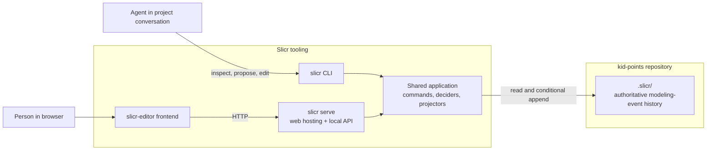
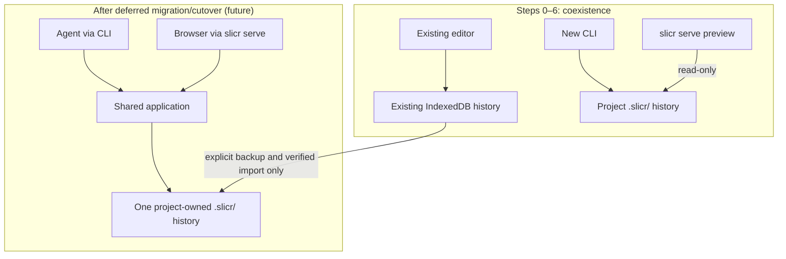
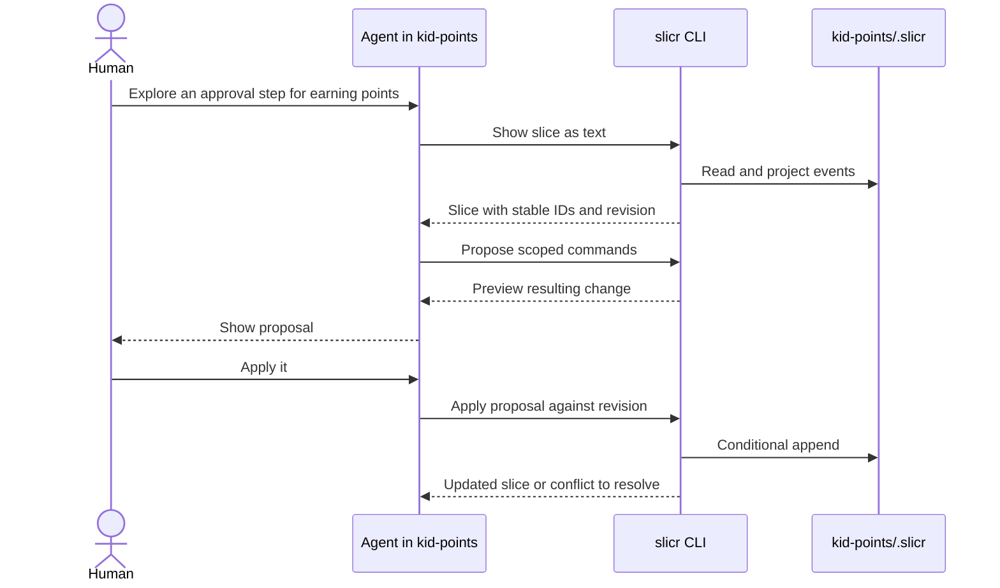
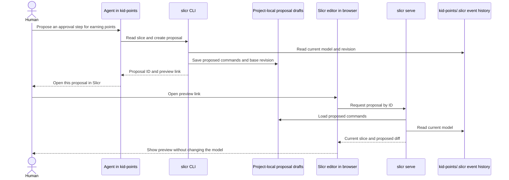

# Project-Owned Event Models: CLI and Visual Editor Access

## Goal

A project such as `kid-points` owns its event model in `./.slicr/`. The `slicr` CLI lets people and agents inspect and edit that model from the project's directory. `slicr serve` hosts the `slicr-editor` frontend against the **same** model. DCB is a project-wide event-sourcing practice.

The event model's history records **modeling events** (such as adding or connecting nodes). Events depicted within the model (such as a hypothetical `PointsEarned` in `kid-points`) are model content, not events in the Slicr modeling history. The on-disk event history is authoritative; JSON and Markdown are derived read models, not alternative write authorities.

This is a proposed target, not current behavior. In particular, the existing frontend persists to browser IndexedDB (with an in-memory fallback outside the browser), and a browser cannot directly open the project's `.slicr/` directory.

## Target architecture

The CLI and `slicr serve` share command and projection semantics. The browser communicates through the local server rather than accessing the repository's files itself. The exact storage format, projection format, and local API transport are not yet decisions.

## Safety rules for every step

- Make each step a bounded, independently shippable change. The application must remain usable at its end: no broken existing workflows, and all tests passing.
- Preserve the existing IndexedDB-backed editor until an explicit, backed-up cutover. Do not silently replace or merge an existing history, or imply that two separate stores are synchronized.
- Treat the event store as the source of truth. All edits, whether from the CLI or web, go through scoped application commands and store-free deciders, not direct agent-authored events or edits to a generated projection.
- Keep atomic DCB conditional-append behavior in every writable store implementation. Test concurrent independent processes, not only two objects in one process. Reject stale operations with an actionable conflict instead of silently overwriting changes.
- Prefer adding an API beside the existing one, migrating consumers, then removing the compatibility path in a later step.
- During each step, run focused tests (prefer `npm run test:llm --workspace=<workspace-name>`). Before completing the step, run `npm run format` and `npm run validate:llm` from the repository root for edited files, plus a manual editor smoke check for user-facing changes. Add automated regression tests for each new contract.

## Incremental steps

### 0. Pin current behavior [DONE]

Cover opening a workspace, editing a node, switching projects/chapters, reopening persisted data, and backup/restore in integration tests. Record a brief manual smoke checklist for startup, editing, switching scope, and reloading. This gives later changes an observable baseline.

**Safe stopping point:** No architecture change; the existing editor still works. Its full test suite and the root validation pass.

### 1. Clarify the application API [DONE]

Complete the already-planned explicit command and read-model APIs in [`../011-read-model-subscriptions/03-tasks.md`](../011-read-model-subscriptions/03-tasks.md) (Tasks 8–9). Separate scoped command execution from workspace and graph projection reads/subscriptions. Retain the existing graph-model facade while consumers migrate; only remove it in a later, separately tested change. Do not mix this with storage migration.

**Safe stopping point:** React continues to use its existing IndexedDB history. Both compatibility and new paths are covered, and the editor smoke check passes.

### 2. Extract the reusable model [DONE]

Move domain events, commands, deciders, domain graph/workspace projections, and their tests into a non-React package. Keep renderer adaptation, layout, measurement, and UI-local state in the frontend. Move imports in small groups without redesigning event payloads or changing persisted history in the same step. A package extraction must not change replay results for existing event fixtures.

**Safe stopping point:** The existing frontend runs with unchanged behavior using the shared package; full root validation and the editor smoke check pass.

### 3. Introduce a project-local store [DONE]

Define how a CLI discovers and initializes `./.slicr/`. Decide a versioned event-history format after evaluating transactional conditional append, process concurrency, portability, backups, and whether generated text rather than the raw store should be Git-tracked. Implement a project-local store adapter behind the event-store contract, with replay and conflict tests. Do not switch the frontend yet. Do not create `.slicr/` merely by running a read command.

**Safe stopping point:** The existing editor still uses IndexedDB. The new store passes shared contract, recovery, and independent-process conflict tests without affecting it.

### 4. Ship a read-only CLI [DONE]

Make `slicr` work from another repository such as `kid-points`, discovering that repository's `.slicr/` (with a clear override for explicit paths). Add commands to list projects/chapters and show a scoped slice as versioned structured JSON and readable Markdown with stable IDs. Include a revision token suitable for later guarded writes. A missing or incompatible model should yield a helpful error, not be silently initialized or rewritten.

**Safe stopping point:** An agent can inspect a project-owned model from the project's directory, but cannot mutate it yet. Test invocation outside the Slicr repository.

### 5. Add CLI edits [DONE]

Expose a small set of explicit scoped commands through the shared application, beginning with one or two well-tested mutations. Add CLI tests for invalid references, failed decisions, concurrent conflicting edits, and reopening a model in another process. Never expose ordinary agent-facing direct event append or backup restore as an edit command.

**Safe stopping point:** Agents can make validated changes to a project-owned model. The existing browser editor remains usable on its separate IndexedDB store; this coexistence must be labeled, not presented as synchronization.

### 5.1 Initialize models, share projections, and expand CLI edits [DONE]

Add an explicit `slicr init` command that initializes a new project's `.slicr/` store without creating domain events. Initialization must never happen as a side effect of a read; refuse to overwrite an existing or incompatible store. Keep project creation separate from store initialization.

Replace the CLI's local event replay/projection logic with the common projections from `slicr-core`, so CLI inspection and shared command decisions use the same model semantics. Preserve stable IDs, scoped slices, and the exact-file-byte revision token.

Add these explicit, scoped CLI commands: `add-project`, `add-chapter`, `add-node`, `rename-node`, and `connect-nodes`. Route each through its existing shared decider and `handleCommand` using the project-local store; do not construct or append domain events in CLI code. Return generated IDs and the resulting revision where applicable. Keep conditional append and actionable conflict behavior, and test invalid references, no-op/failed decisions, concurrent conflicts, and visibility after reopening in another process. Add initialization tests for a new store and for existing or incompatible stores, confirming that no existing history is overwritten.

**Safe stopping point:** An agent can explicitly initialize a project store, create a project and chapter, add and rename nodes, and connect nodes using the common projections and validated shared commands. CLI and browser storage remain separate and unsynchronized; this step does not switch the frontend or imply a cutover.

### 6. Add `slicr serve`, initially read-only [DONE]

Host the current frontend assets plus a local projection API pointing to the selected project's `.slicr/`. Start with read-only views and an unmistakable indication of the opened project and store. Keep the existing frontend startup path until the served path is proven. Test server start, projection reads, missing/corrupt store behavior, and shutdown.

**Safe stopping point:** The project-local model is visually inspectable, but there is not yet a second write path to reconcile. **Completed:** manual browser smoke checks passed; see [`12-step6-scope-changes.md`](./12-step6-scope-changes.md).

### 7. Serve project-backed editing [DONE — current scoped slice]

Route the served editor's available edits through the local API and the same project store as the CLI. The served UI supports adding and renaming nodes; the guarded API supports `RenameNode`, `AddNode`, `ConnectNodes`, `AddChapter`, and `RenameProject`. Writes use shared deciders and command handling, validate command payloads, include a base revision enforced at the store's cross-process append boundary, and reject stale edits. Polling provides cross-process catch-up without relying on process-local subscriptions. Tests cover CLI/browser propagation, restart, malformed requests, conflicts, and refresh behavior. The manual editor smoke check passed. See [`13-step7-scope-changes.md`](./13-step7-scope-changes.md).

The existing standalone editor remains on its IndexedDB store; it is separate and unsynchronized with the `.slicr/` store. The served UI does not yet expose full standalone editing parity (property edits, deletion/type changes, and connection gestures); treat those as follow-up work rather than implying they are implemented.

**Safe stopping point:** CLI and the currently supported served-editor controls read/write the same project-owned history; the standalone IndexedDB workflow remains available and separate.

### 7.1. Migrate browser history and cut over [DEFERRED]

Provide an explicit, backed-up, verified migration from existing browser histories to `.slicr/`; define what happens if the destination already has events. Switch a user/project only after successful verification and retain a recovery path. Remove the old default write path only after migrated workflows pass regression tests. This substep is explicitly deferred; do not imply migration, synchronization, or cutover.

**Safe stopping point:** After this substep is resumed and completed, browser migration/recovery is tested and the selected project's workflows use one authoritative project history.

### 8. Bring the project-backed editor to full visual and feature parity

Complete the production-editor experience for the project-backed entry point, using the same project API and `.slicr/` history as the CLI. Treat the existing standalone editor as the UI and interaction baseline: consolidate its controls over a project-backed application/API adapter instead of rebuilding parallel controls or redesigning the editor. Keep storage-specific behavior behind that adapter; UI components should not choose between direct IndexedDB writes and direct API calls. Preserve the visible project/store identity and revision as project-specific safety context.

**UI consolidation and visual/interaction gaps to close (not a UI rebuild):**

- Reuse the existing project switcher, chapter sidebar, node/edge components, detail panel, menus, and interaction state wherever available. Where the project entry point currently substitutes simple selectors or wires existing controls to no-ops, connect those controls to the project-backed read model and command adapter rather than creating new versions of them.
- Reconcile the project entry point with the existing production navigation and interaction behavior: project create/rename, chapter creation, sidebar collapse/expand, node selection/focus, focused-node detail, property focus/hover highlighting, context menus, connected-node creation, connection mode feedback/cancel, and existing node/edge styling and layout.
- Keep the existing keyboard and pointer interactions for focus navigation, label editing/cancel, connect/cancel, add-connected-node, node type changes, and deletion. Treat these as existing behavior to preserve and wire to project commands—not new interaction concepts to design. Keep the project editor's explicit project/store/revision identity visible.

**Read-operation gaps to close:**

- The project view can currently list projects/chapters and render the all-chapter or chapter-scoped graph, including nodes, edges, schemas, and example values. However, node clicks do not focus/select a node, and there is no focused-node detail/property view or focused/hovered-property read state. Wire the existing standalone inspection/detail behavior to project-backed reads so users can inspect the same node and property information.
- Preserve stable project/chapter/node identity and display the selected scope consistently. Add tests for switching project/chapter scope and reading nodes with schemas/examples and connected/disconnected edges.

**Write-operation gaps to close:**

- Current project UI routes only `AddNode` (with hard-coded type/lane/label choices) and `RenameNode` through project commands. Wire the existing standalone controls for project operations (`AddProject`, `RenameProject`), chapter creation, and node operations—add slice, add connected node, rename, change type, delete, and edit property schema/example values—to the project-backed command adapter. Add API command support only where the existing controls' operations are not yet supported.
- Wire the existing connection gestures and disconnection/deletion controls to project commands. The server currently accepts `ConnectNodes` but the project entry point does not expose its existing UI interaction; add the required scoped `NodesDisconnected`/equivalent command path as well.
- Route every mutation through validated project API commands and the shared deciders/`handleCommand`. Include the latest base revision, preserve atomic cross-process conflict rejection, and keep browser-to-CLI/CLI-to-browser catch-up. Do not append events directly from the UI.

**Explicit exclusions and project-store behavior:**

- Do not add browser-history backup/restore or migration; Git-tracked `.slicr/events.ndjson` is the project backup/versioning path.
- Do not reproduce the standalone editor's mockup/demo galleries or its layout-test-case export controls; those are design/testing tools, not project-modeling features.
- Do not reproduce IndexedDB/localStorage persistence or its last-known-good-model fallback. Keep `.slicr/` authoritative and report missing/corrupt project data; never silently substitute stale browser state.
- Keep initialization explicit through `slicr init`; opening or reading a project must not initialize it implicitly.
- Update `slicr init` to create or safely maintain `.slicr/.gitignore` that ignores the SQLite outbox (and its transient journal files) while leaving `events.ndjson` trackable. Preserve existing user ignore rules and test both new and existing `.gitignore` cases.
- Agent proposals/preview/apply remain separate future steps (Steps 9–10 below), not part of this parity step.

**Safe stopping point:** The project-backed editor matches the standalone editor's production visual and read/write workflows except for the exclusions above. Run full root validation and manual project-editor smoke coverage for project/chapter navigation, reading node/property data, every editing gesture, stale conflicts, and cross-process catch-up.

### 9. Add agent proposals

Add `propose`/preview before `apply`: show the resulting slice diff without recording exploratory changes, then conditionally apply an approved proposal against its read revision. A stale proposal must be rejected for re-reading, not silently rebased. Store proposals separately from the authoritative event history and give each proposal a stable ID and base revision so it can be inspected from another client. Decide draft retention and cleanup explicitly.

**Safe stopping point:** Agents can explore alternatives safely and humans can approve changes in the conversation. Proposal creation and preview append no events; full validation and the editor smoke check pass.

### 10. Preview an agent proposal in the browser

Give the agent a link containing a proposal ID that opens the proposal in the served editor. `slicr serve` loads the project-local draft, reads the current model, and displays a visual diff without applying commands. Show when the proposal is stale and require explicit approval before any conditional append. Test agent CLI creation to browser preview, refresh/restart, unknown IDs, stale drafts, and the invariant that viewing a proposal never changes the event history. Keep proposal drafts distinct from the authoritative `.slicr/` modeling-event log.

**Safe stopping point:** A user can ask an agent for a proposal, inspect it visually, and leave without changing the model. All tests and the editor smoke check pass.

### 11. Package the CLI for Git-based installation

Produce a versioned, reproducible npm package artifact for the CLI that can be installed by projects outside this monorepo from a Git-hosted release asset. Keep the root `npm run slicr -- ...` command as a development convenience, separate from the distributable package. The installed artifact must include its executable entry point and all required runtime code, must not depend on monorepo-relative paths or private workspace packages, and must document its supported Node version. Bundle the shared runtime into the artifact or make every runtime dependency independently installable; do not assume workspace symlinks exist in a consumer project. Publish or attach the packed `.tgz` to a Git-hosted release, with package version and release tag aligned.

Test packing and installing the artifact in a clean temporary consumer project using the Git-hosted release asset (or a local packed artifact as a pre-release check). From that consumer project, verify the installed `slicr` command discovers its local `.slicr/` model, supports explicit `--path`, and can run the supported read and edit commands without access to the Slicr checkout. Also verify missing/incompatible models fail safely, and that the package can later be published to a registry without changing its runtime layout.

**Safe stopping point:** An external project can install the versioned CLI artifact from the Git host and use it independently of the monorepo; the root forwarding script continues to work for development. Package contents, Node requirement, version/tag, and installation instructions are documented. This step does not itself require registry publication.

## Intended agent interaction

## Browser-based proposal preview

## First tranche and decisions to revisit

Implement Steps 0–2 first and review the results before settling the `.slicr/` storage format. Later choices requiring explicit discussion include whether the authoritative store is Git-tracked, how to handle branches and merges, how revisions and agent identity are represented, how `slicr serve` is secured to localhost, and how older event schemas are upgraded. None is decided by this plan.
