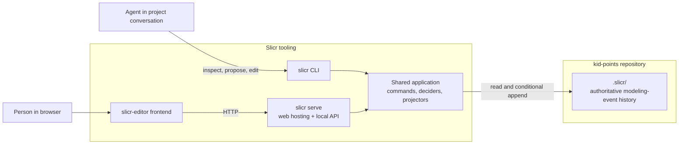
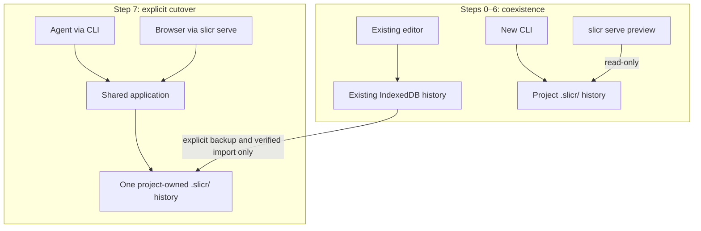
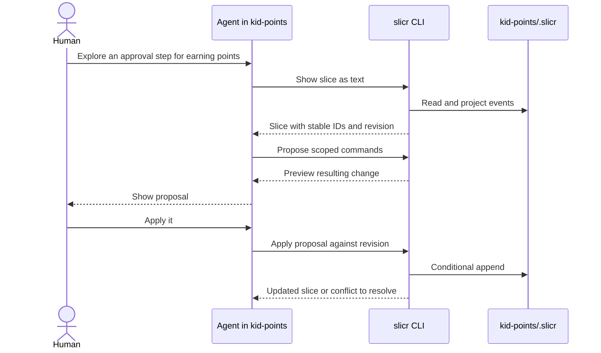
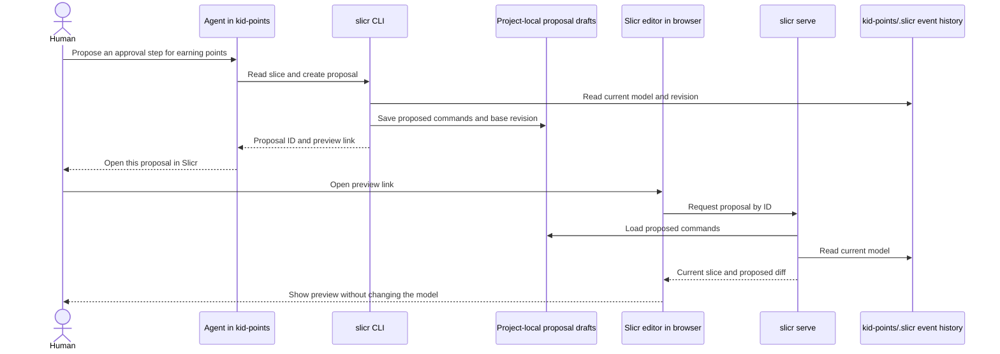

# Project-Owned Event Models: CLI and Visual Editor Access

## Goal

A project such as `kid-points` owns its event model in `./.slicr/`. The `slicr` CLI lets people and agents inspect and edit that model from the project's directory. `slicr serve` hosts the `slicr-editor` frontend against the **same** model. DCB is a project-wide event-sourcing practice.

The event model's history records **modeling events** (such as adding or connecting nodes). Events depicted within the model (such as a hypothetical `PointsEarned` in `kid-points`) are model content, not events in the Slicr modeling history. The on-disk event history is authoritative; JSON and Markdown are derived read models, not alternative write authorities.

This is a proposed target, not current behavior. In particular, the existing frontend persists to browser IndexedDB (with an in-memory fallback outside the browser), and a browser cannot directly open the project's `.slicr/` directory.

## Target architecture

The CLI and `slicr serve` share command and projection semantics. The browser communicates through the local server rather than accessing the repository's files itself. The exact storage format, projection format, and local API transport are not yet decisions.

## Safety rules for every step

- Make each step a bounded, independently shippable change. The application must remain usable at its end: no broken existing workflows, and all tests passing.
- Preserve the existing IndexedDB-backed editor until an explicit, backed-up cutover. Do not silently replace or merge an existing history, or imply that two separate stores are synchronized.
- Treat the event store as the source of truth. All edits, whether from the CLI or web, go through scoped application commands and store-free deciders, not direct agent-authored events or edits to a generated projection.
- Keep atomic DCB conditional-append behavior in every writable store implementation. Test concurrent independent processes, not only two objects in one process. Reject stale operations with an actionable conflict instead of silently overwriting changes.
- Prefer adding an API beside the existing one, migrating consumers, then removing the compatibility path in a later step.
- During each step, run focused tests (prefer `npm run test:llm --workspace=<workspace-name>`). Before completing the step, run `npm run format` and `npm run validate:llm` from the repository root for edited files, plus a manual editor smoke check for user-facing changes. Add automated regression tests for each new contract.

## Incremental steps

### 0. Pin current behavior [DONE]

Cover opening a workspace, editing a node, switching projects/chapters, reopening persisted data, and backup/restore in integration tests. Record a brief manual smoke checklist for startup, editing, switching scope, and reloading. This gives later changes an observable baseline.

**Safe stopping point:** No architecture change; the existing editor still works. Its full test suite and the root validation pass.

### 1. Clarify the application API [DONE]

Complete the already-planned explicit command and read-model APIs in [`../011-read-model-subscriptions/03-tasks.md`](../011-read-model-subscriptions/03-tasks.md) (Tasks 8–9). Separate scoped command execution from workspace and graph projection reads/subscriptions. Retain the existing graph-model facade while consumers migrate; only remove it in a later, separately tested change. Do not mix this with storage migration.

**Safe stopping point:** React continues to use its existing IndexedDB history. Both compatibility and new paths are covered, and the editor smoke check passes.

### 2. Extract the reusable model

Move domain events, commands, deciders, domain graph/workspace projections, and their tests into a non-React package. Keep renderer adaptation, layout, measurement, and UI-local state in the frontend. Move imports in small groups without redesigning event payloads or changing persisted history in the same step. A package extraction must not change replay results for existing event fixtures.

**Safe stopping point:** The existing frontend runs with unchanged behavior using the shared package; full root validation and the editor smoke check pass.

### 3. Introduce a project-local store

Define how a CLI discovers and initializes `./.slicr/`. Decide a versioned event-history format after evaluating transactional conditional append, process concurrency, portability, backups, and whether generated text rather than the raw store should be Git-tracked. Implement a project-local store adapter behind the event-store contract, with replay and conflict tests. Do not switch the frontend yet. Do not create `.slicr/` merely by running a read command.

**Safe stopping point:** The existing editor still uses IndexedDB. The new store passes shared contract, recovery, and independent-process conflict tests without affecting it.

### 4. Ship a read-only CLI

Make `slicr` work from another repository such as `kid-points`, discovering that repository's `.slicr/` (with a clear override for explicit paths). Add commands to list projects/chapters and show a scoped slice as versioned structured JSON and readable Markdown with stable IDs. Include a revision token suitable for later guarded writes. A missing or incompatible model should yield a helpful error, not be silently initialized or rewritten.

**Safe stopping point:** An agent can inspect a project-owned model from the project's directory, but cannot mutate it yet. Test invocation outside the Slicr repository.

### 5. Add CLI edits

Expose a small set of explicit scoped commands through the shared application, beginning with one or two well-tested mutations. Add CLI tests for invalid references, failed decisions, concurrent conflicting edits, and reopening a model in another process. Never expose ordinary agent-facing direct event append or backup restore as an edit command.

**Safe stopping point:** Agents can make validated changes to a project-owned model. The existing browser editor remains usable on its separate IndexedDB store; this coexistence must be labeled, not presented as synchronization.

### 6. Add `slicr serve`, initially read-only

Host the current frontend assets plus a local projection API pointing to the selected project's `.slicr/`. Start with read-only views and an unmistakable indication of the opened project and store. Keep the existing frontend startup path until the served path is proven. Test server start, projection reads, missing/corrupt store behavior, and shutdown.

**Safe stopping point:** The project-local model is visually inspectable, but there is not yet a second write path to reconcile.

### 7. Switch served editing on with an explicit cutover

Route frontend edits through the local API and the same project-local store as the CLI. Add cross-process update/catch-up behavior so CLI writes appear in the browser and browser writes appear in a subsequent CLI read; in-process store subscriptions alone are insufficient. Confirm concurrent edits reject or resolve conflicts without losing history. Provide an explicit, backed-up, verified migration from existing browser histories to `.slicr/`; define what happens if the destination already has events. Switch a user/project only after successful verification, and retain a recovery path. Remove the old default write path only after migrated workflows pass their regression tests.

**Safe stopping point:** Both served editor and CLI read and write one authoritative project history. Test CLI-to-browser and browser-to-CLI propagation, conflict handling, restart, and migration/recovery, then run the full editor smoke check.

### 8. Add agent proposals

Add `propose`/preview before `apply`: show the resulting slice diff without recording exploratory changes, then conditionally apply an approved proposal against its read revision. A stale proposal must be rejected for re-reading, not silently rebased. Store proposals separately from the authoritative event history and give each proposal a stable ID and base revision so it can be inspected from another client. Decide draft retention and cleanup explicitly.

**Safe stopping point:** Agents can explore alternatives safely and humans can approve changes in the conversation. Proposal creation and preview append no events; full validation and the editor smoke check pass.

### 9. Preview an agent proposal in the browser

Give the agent a link containing a proposal ID that opens the proposal in the served editor. `slicr serve` loads the project-local draft, reads the current model, and displays a visual diff without applying commands. Show when the proposal is stale and require explicit approval before any conditional append. Test agent CLI creation to browser preview, refresh/restart, unknown IDs, stale drafts, and the invariant that viewing a proposal never changes the event history. Keep proposal drafts distinct from the authoritative `.slicr/` modeling-event log.

**Safe stopping point:** A user can ask an agent for a proposal, inspect it visually, and leave without changing the model. All tests and the editor smoke check pass.

## Intended agent interaction

## Browser-based proposal preview

## First tranche and decisions to revisit

Implement Steps 0–2 first and review the results before settling the `.slicr/` storage format. Later choices requiring explicit discussion include whether the authoritative store is Git-tracked, how to handle branches and merges, how revisions and agent identity are represented, how `slicr serve` is secured to localhost, and how older event schemas are upgraded. None is decided by this plan.
