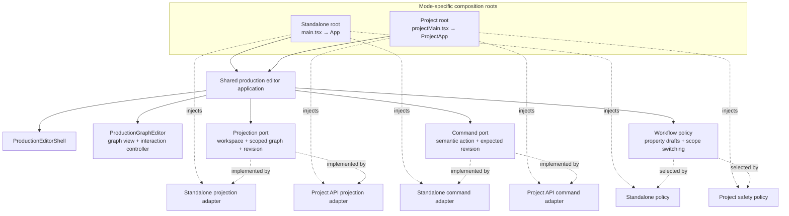
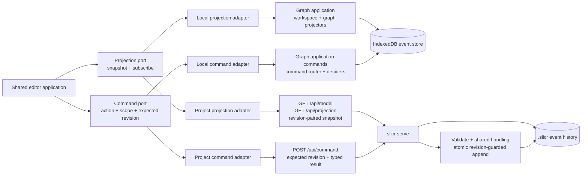

# Shared Editor Application Architecture

## Summary

Refactor the standalone and project-backed editor compositions around one shared production editor application with separate projection/read and command/write ports. Each mode supplies its own adapter pair and workflow policy. This is a follow-up to Task 012, not a prerequisite for its scoped parity closeout.

## Goals

- Share editor-level orchestration while keeping storage and transport outside UI components.
- Define a projection port that returns coherent workspace and scoped graph read models, including the observed revision, and supports updates/subscriptions.
- Define a command port that accepts semantic editor actions with scope and expected revision and returns a receipt or a typed failure/conflict.
- Compose the shared editor with a standalone IndexedDB adapter or a project HTTP/API adapter.
- Preserve mode-specific property-save and scope-switch guarantees as explicit policies rather than flattening them into one behavior.

## Non-goals

- Do not migrate, merge, or synchronize IndexedDB history with `.slicr/`.
- Do not replace project-store revision-guarded atomic append with client-only checks.
- Do not add implicit project initialization, browser fallback, backup/restore parity, mockup galleries, or proposal workflows.
- Do not remove standalone-only or project-only capabilities merely to force identical entry points.

## Core rules

- The UI and shared editor application depend on ports, not direct IndexedDB or HTTP calls.
- A command uses the revision associated with the read snapshot on which the user acted; adapters must not silently rebase it.
- Project conflicts remain typed and actionable, and the server/store enforces the expected revision atomically.
- A project read snapshot containing workspace and graph data must define how both portions share a revision, including when the API obtains them from separate endpoints.
- Standalone and project stores remain independent authorities.
- Mode-specific property draft, retry, conflict, and scope-switch semantics remain explicit at the application/workflow boundary.

## Target architecture

The entry points are composition roots: each selects a projection adapter, a command adapter, and an explicit mode policy, then mounts the same editor application. The shared application depends on ports and does not branch on IndexedDB versus HTTP.

Reads and writes remain separate at the port boundary while each mode's adapters retain their own consistency and persistence behavior:

The app-level workflow can be shared without pretending the policies are identical: standalone keeps its local property debounce/flush behavior; project mode keeps its serialized queue, conflict guidance, and wait/discard/stay scope guard. Optional backup/export/mockup and project-identity capabilities remain attached only to the relevant composition.

## Target contracts

A projection port should expose the workspace/project/chapter read model and scoped graph snapshot, including node schemas, example values, stable identities, and a revision. It should expose a subscription or refresh contract; polling versus local event subscription remains adapter-owned.

A command port should accept a typed semantic `EditorAction`, scope, and expected revision. It should return the committed revision and generated identities where applicable, and represent validation, conflict, and operational failures without erasing their distinctions.

The shared editor application composes those ports with the shared shell, graph view, and interaction controller. Composition roots select the mode's adapters and inject its property-save/scope-switch policy and optional capabilities.

## Implementation shape

- Replace the combined `ProductionEditorPort` dependency with separate application-facing projection and command contracts.
- Adapt the local graph application/projector and command router to the contracts while preserving IndexedDB/event-store behavior.
- Adapt the project read API and guarded command endpoint while preserving revision convergence, atomic append, typed conflicts, and receipts.
- Extract the common app-level editor orchestration currently split between `App`/`useGraphModel` and `ReadOnlyProjectApp`.
- Keep mode-specific policy objects and capability slots for standalone backup/export/mockups and project identity/conflict/scope UI.

## Test plan

- Add contract tests for each projection and command adapter, including scope, revision, subscription, receipt, and conflict behavior.
- Test the shared editor application against fake ports without coupling it to either store.
- Keep browser integration tests for each real entry point, including project stale-conflict and scope-switch safety, and standalone persistence/backup behavior.
- Verify shared UI code has no direct IndexedDB or project API writes.

## Follow-up boundary

The ports and shared composition must preserve the separate IndexedDB and `.slicr/` authorities. This task is architecture work only; it does not perform browser-history migration or cutover.
