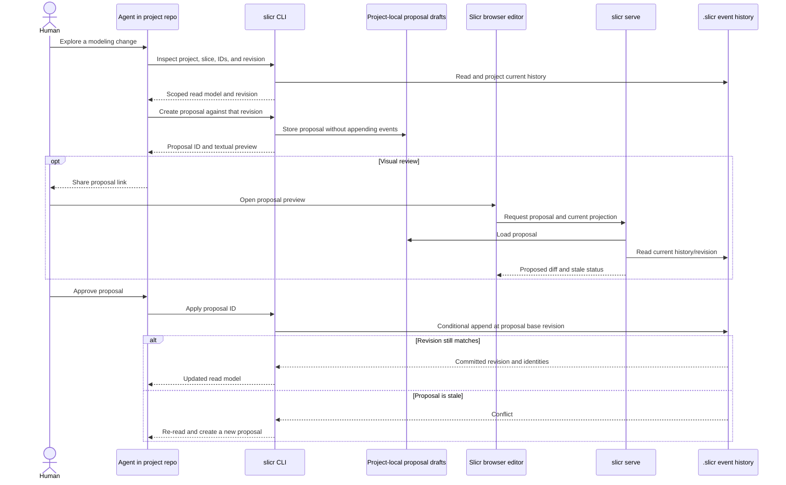

# Agent Interaction with Project-Owned Models

## Summary

Define the full agent-assisted modeling workflow against a project's authoritative `.slicr/` history: inspect the current model, prepare and preview a proposal, let a human review it (in the CLI or browser), then conditionally apply the approved commands. Existing CLI read/edit commands are the foundation; this task adds the proposal and review lifecycle rather than reducing agent interaction to proposal storage alone.

## Goals

- Let an agent inspect projects, chapters, graph slices, stable identities, and the current revision through the supported CLI.
- Let an agent create a scoped proposal with a stable proposal ID and base revision without changing the event history.
- Preview the proposed result in the CLI and, optionally, in the browser through `slicr serve`.
- Apply only after explicit human approval, using shared command handling and atomic expected-revision checks.
- Reject stale proposals for re-reading and revision, never silently rebase them.
- Keep proposal drafts separate from the authoritative project event history and define their retention/cleanup behavior.

## Non-goals

- Do not append events directly from an agent or browser.
- Do not apply proposals automatically or treat opening a preview as approval.
- Do not merge, migrate, or synchronize browser IndexedDB history with `.slicr/`.
- Do not package or release the CLI; that is tracked separately in [016](../016-git-installed-cli/02-plan.md).

## Core rules

- `.slicr/` remains the source of truth; proposal creation, inspection, and preview append no modeling events.
- Every proposal records its project/scope and the revision it was derived from.
- Apply routes typed commands through shared deciders/`handleCommand` and the project store's atomic conditional append.
- A stale base revision is an actionable conflict requiring the agent to inspect and propose again.
- Proposal IDs are stable across CLI, browser, refresh, and server restart for the configured retention period.
- A human's approval is explicit and separate from agent proposal creation or preview.

## Proposal model

A proposal contains a stable ID, project identity, scope, base revision, ordered typed commands, and lifecycle metadata needed to identify whether it is pending, applied, rejected as stale, or expired. It is stored outside the modeling-event log. Retention and cleanup rules must be specified before implementation; proposal drafts must never become an alternative write authority.

## Workflow

## Implementation shape

- Build on the existing CLI project inspection and validated command paths.
- Add proposal draft persistence and CLI operations to create, inspect, preview, and conditionally apply proposals.
- Add a served browser preview route that displays the current model against the proposed result without writing events.
- Keep proposal-draft access separate from the project event store and constrain server access to the intended local workflow.

## Test plan

- CLI tests prove proposal creation and preview do not change the event history, and that IDs/base revisions survive reopen/restart.
- Apply tests cover approval, successful atomic append, stale-revision conflict, unknown proposal ID, repeated apply, and invalid commands.
- Browser tests cover CLI-to-browser preview, refresh/restart, stale indication, unknown IDs, and the invariant that viewing a proposal never mutates the model.
- Verify a stale proposal must be re-read and recreated rather than rebased.

## Open decisions

- Define proposal retention and cleanup.
- Specify how proposals behave across project branches/merges and how agent identity, if any, is recorded. These decisions must not weaken revision guards or imply history synchronization.
